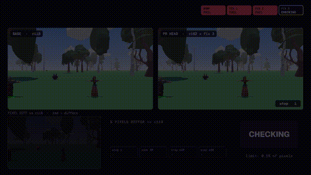
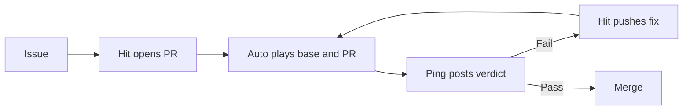

# COGGS Hit + COGGS Auto

COGGS Hit upgrades your game; COGGS Auto plays the pull request and catches what a code diff cannot show.

[](docs/media/upgrade.mp4)

[Watch the 30-second upgrade replay](docs/media/upgrade.mp4) · [See a real CI verdict](https://github.com/DaedalGames/auto-hit/pull/1#issuecomment-6730606274) · Final demo: **TODO(live)**

Built at c0mpiled-17 Seoul, 2026-11-09, for the Self-Maintaining APIs track.

## See it on real PRs

| Game | Issue | Upgrade pull request | Play verdict |
| --- | --- | --- | --- |
| Quick 3D RPG, three.js r118 → r162 | TODO(live) | TODO(live) | [CI comment](https://github.com/DaedalGames/auto-hit/pull/1#issuecomment-6730606274) |
| Crossy Road, three.js r99 → r162 | TODO(live) | TODO(live) | TODO(live) |

## Why play the upgrade?

| Approach | What happens | Evidence |
| --- | --- | --- |
| A. Version bump only | The game shows a black screen: `Failed to resolve module specifier three`. Whether existing checks would let it merge is **TODO(live)**. | [Bump probe](docs/media/probe-results.json) (`runs.r162-bump`) |
| B. Bump + code review | Reviewers read the change; whether CodeRabbit, gstack /review or open-code-review catches the FBX color shift is **TODO(live)**. | [Fix 2 replay](docs/media/probe-results.json) (`diffs.r118-a vs r162-fix2-a`): 7.58–24.87% of pixels differ. |
| C. Hit + Auto | A deterministic replay exposes the change; after three fixes the four sampled frames pass at 0.0202–0.0393% difference. | [Probe measurements](docs/media/probe-results.json) (`diffs.r118-a vs r162-fix3-a`); [real PR comment](https://github.com/DaedalGames/auto-hit/pull/1#issuecomment-6730606274). |

The standalone probe compares four frames at steps 1, 60, 120 and 180 against a 0.1% pixel-difference limit. A twice-run baseline differed by **0 pixels** at those frames. The pass is not a claim about every frame: the same capture exceeded the limit at steps 6 and 8. The real CI comment is a separate run; its verdict is the evidence for that PR.

## The advantage

- **Deterministic replay:** the same inputs, seeded randomness and controlled clock make before-and-after frames comparable. The twice-run baseline is in the [probe data](docs/media/probe-results.json).
- **A play oracle:** Auto runs the game, captures frames and reports pixel differences, including failures that are invisible in a code diff. It checks the recorded route and sampled frames, not every possible playthrough.
- **Memory across games:** Hit's `tools/brain.mjs` records and retrieves upgrade knowledge so later work can reuse it. Cross-game benefit: **TODO(live)** measurement.

## How it works



## Run COGGS Auto

Requires Node.js 24+, npm and a second checkout to compare.

1. `npm ci && npx playwright install --only-shell chromium` installs the player and the three.js versions it serves locally.
2. `node auto/depth-first-qa.mjs --base . --head ../other-checkout --out out.local` replays every changed game under `games/` on both checkouts with the route in `.coggs/depth-first-qa/<game>.json`.
3. Add `--games quick3drpg` to play one game even when it did not change; `--base . --head .` must report 0% on every frame.
4. Read `out.local/verdict.json` and `out.local/comment.md`; frames and red diff images sit in `out.local/<game>/`. The exit code is 0 on PASS and 1 on FAIL.
5. In CI, `.github/workflows/coggs-auto.yml` does the same on every pull request and Daedal Ping posts the comment.

## Run COGGS Hit

COGGS Hit runs on the maintainer's machine with the signed-in `claude` CLI and acts through local `git` and `gh`, so every push starts COGGS Auto like any human push. One run takes one game in this repository from an old engine version to a new one:

```sh
node hit/run.mjs --game games/quick3drpg --dep three --from 0.118.1 --to 0.162.0 --no-brain
```

1. It files an issue, labelled `dependencies`, saying how many releases the game is behind, with the migration guide entries that touch APIs the game uses.
2. It opens the pull request that fixes the issue (`Fixes #n`); its first commit changes only the version strings.
3. Each COGGS Auto FAIL on the head commit starts one `claude -p` call (10 minute limit) that follows [.coggs/hit.md](.coggs/hit.md), reads the verdict and the guide in [.coggs/guides/](.coggs/guides/), may edit only the game folder, and must leave exactly one `fix(hit): <cause>` commit with `Evidence:` and `Source:` lines. A call that breaks those rules is undone.
4. One COGGS Hit status comment on the pull request is edited in place after every step.
5. On PASS it squash-merges as `<title> (#n)`, which closes the issue, deletes the branch and reads the link back. After three fixes without PASS it labels the pull request `needs-human` instead.

Every step is a line in `hit/out/<pr>.jsonl`, including attempts to PASS. Without `--no-brain`, Hit asks `tools/brain.mjs` for causes found in earlier games before each fix and adds one lesson per fix commit after PASS. `--pr <n>` resumes an open pull request, and `node hit/guide.mjs --dep three --from <v> --to <v>` refetches a guide from the three.js wiki.

## Business model

The opportunity and pricing hypothesis are in [docs/BM.md](docs/BM.md).

## Credits and licenses

[Quick 3D RPG](https://github.com/simondevyoutube/Quick_3D_RPG) by simondevyoutube is [MIT licensed](games/quick3drpg/LICENSE); bundled assets carry their own license files under `games/quick3drpg/resources/`. [Crossy Road](https://github.com/GeekBoySupreme/crossy-road) by Shuvam Manna is [MIT licensed](games/crossyroad/LICENSE); see its [notice](games/crossyroad/NOTICE). This repository is MIT licensed as declared in `package.json`.
