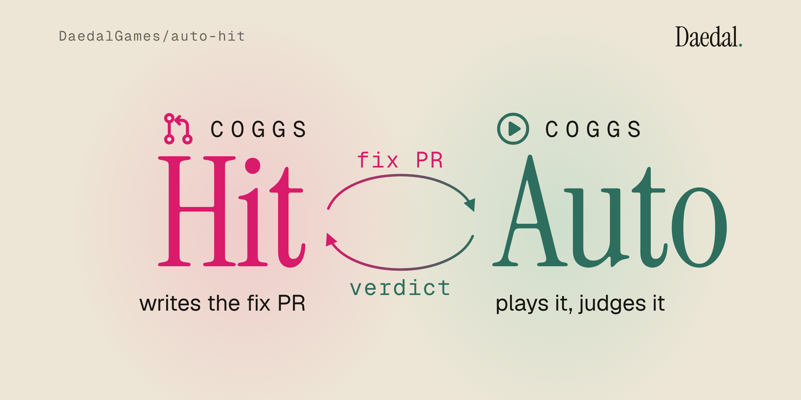
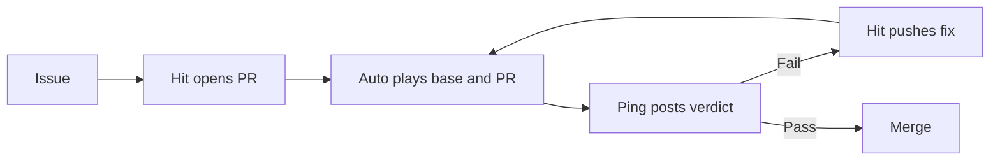

<picture>
  <source media="(prefers-color-scheme: dark)" srcset="docs/media/banner/banner-dark@2x.png">
  <source media="(prefers-color-scheme: light)" srcset="docs/media/banner/banner-light@2x.png">
  
</picture>

# COGGS Hit + COGGS Auto

COGGS Hit upgrades your game; COGGS Auto plays the pull request and catches what a code diff cannot show.

https://github.com/user-attachments/assets/7a0dbf9d-cd4f-4c8b-96d6-b00e5648b9d3

The 90-second demo above runs on this repository's own issues and pull requests: Hit files the issue, opens the upgrade, Daedal Ping posts Auto's verdict, Hit fixes until PASS, and the merge closes the issue.

<details>
<summary>The 30-second replay: one game, four steps, black screen to PASS</summary>

https://github.com/user-attachments/assets/bfadca95-e7ce-475b-a14c-06f1c2069fe2

A version bump draws a black screen, two fixes still differ, the third passes at 0.02% of pixels.

</details>

Built at c0mpiled-17 Seoul, 2026-11-09, for the Self-Maintaining APIs track.

## See it on real PRs

| Game | Issue | Upgrade pull request | Play verdict |
| --- | --- | --- | --- |
| Quick 3D RPG, three.js r118 → r162 | [#2](https://github.com/DaedalGames/auto-hit/issues/2), closed | [#3](https://github.com/DaedalGames/auto-hit/pull/3), merged | [PASS](https://github.com/DaedalGames/auto-hit/pull/3#issuecomment-6730924781) at 0.01–0.04% differ after [7 fixes](https://github.com/DaedalGames/auto-hit/pull/3#issuecomment-6730962200); brain enabled for fix 7 |
| Crossy Road, three.js r99 → r162 | [#4](https://github.com/DaedalGames/auto-hit/issues/4), closed | [#5](https://github.com/DaedalGames/auto-hit/pull/5), merged | [PASS](https://github.com/DaedalGames/auto-hit/pull/5#issuecomment-6731006844) after [4 fixes](https://github.com/DaedalGames/auto-hit/pull/5#issuecomment-6730986797), max 0.10% differ |

## Why play the upgrade?

| Approach | What happens | Evidence |
| --- | --- | --- |
| A. Version bump only | The game shows a black screen: `Failed to resolve module specifier three`. CodeQL and code analysis still pass; only COGGS Auto fails it. | [PR #1 checks](https://github.com/DaedalGames/auto-hit/pull/1/checks) and [Auto's verdict](https://github.com/DaedalGames/auto-hit/pull/1#issuecomment-6730606274) |
| B. Bump + code review | The scoped review identified texture color-space and lighting regressions; open-code-review flagged two texture encoding bugs. It did not run exploratory play. | [Quick 3D RPG review](https://github.com/DaedalGames/auto-hit/pull/3#issuecomment-6730990776); [Crossy Road review](https://github.com/DaedalGames/auto-hit/pull/5#issuecomment-6731253101). |
| C. Hit + Auto | The independent Quick 3D RPG probe passed four frames after three fixes at 0.0202–0.0393%. | [Crossy Road verdict](https://github.com/DaedalGames/auto-hit/pull/5#issuecomment-6731006844) and [fix history](https://github.com/DaedalGames/auto-hit/pull/5#issuecomment-6730986797); [probe measurements](docs/media/probe-results.json) (`diffs.r118-a vs r162-fix3-a`). |

The standalone probe compares four frames at steps 1, 60, 120 and 180 against a 0.1% pixel-difference limit. A twice-run baseline differed by **0 pixels** at those frames. The pass is not a claim about every frame: the same capture exceeded the limit at steps 6 and 8. The real CI comment is a separate run; its verdict is the evidence for that PR.

## The advantage

- **Deterministic replay:** the same inputs, seeded randomness and controlled clock make before-and-after frames comparable.
- **A play oracle:** Auto runs the game, captures frames and reports pixel differences, including failures that are invisible in a code diff. It checks the recorded route and sampled frames, not every possible playthrough.
- **Memory across games:** every fix that reaches PASS becomes a lesson in [brain/lessons/](brain/lessons/) (15 after today's two upgrades), and Hit queries them through `tools/brain.mjs` before every fix. How many attempts it saves is not measured yet.

## How it works



## Run COGGS Auto

Requires Node.js 24+, npm and a second checkout to compare.

1. `npm ci && npx playwright install --only-shell chromium` installs the player and the three.js versions it serves locally.
2. `node auto/depth-first-qa.mjs --base . --head ../other-checkout --out out.local` replays every changed game under `games/` on both checkouts with the route in `.coggs/depth-first-qa/<game>.json`.
3. Add `--games quick3drpg` to play one game even when it did not change; `--base . --head .` must report 0% on every frame.
4. Read `out.local/verdict.json` and `out.local/comment.md`; frames and red diff images sit in `out.local/<game>/`. The exit code is 0 on PASS and 1 on FAIL.
5. In CI, `.github/workflows/coggs-auto.yml` does the same on every pull request and Daedal Ping posts the comment.

## Run COGGS Hit

COGGS Hit runs on the maintainer's machine with the signed-in `claude` CLI and acts through local `git` and `gh`, so every push starts COGGS Auto like any human push. One run takes one game in this repository from an old engine version to a new one:

```sh
node hit/run.mjs --game games/quick3drpg --dep three --from 0.118.1 --to 0.162.0 --no-brain
```

1. It files an issue, labelled `dependencies`, saying how many releases the game is behind, with the migration guide entries that touch APIs the game uses.
2. It opens the pull request that fixes the issue (`Fixes #n`); its first commit changes only the version strings.
3. Each COGGS Auto FAIL on the head commit starts one `claude -p` call (10 minute limit, file tools only) that follows [.coggs/hit.md](.coggs/hit.md), reads the verdict and the guide in [.coggs/guides/](.coggs/guides/), edits the game folder and names the cause, the evidence and the source. Hit commits that as one `fix(hit): <cause>` commit with `Evidence:` and `Source:` lines; a call that edits outside the game folder or names no cause is undone.
4. One COGGS Hit status comment on the pull request is edited in place after every step.
5. On PASS it squash-merges as `<title> (#n)`, which closes the issue, keeps the branch as the archive of every attempt, and reads the link back; `--no-merge` stops at PASS instead. After 6 fixes without PASS (`--max-fixes`, counted over the fix commits on the branch) it labels the pull request `needs-human`.

Every step is a line in `hit/out/<pr>.jsonl`, including attempts to PASS. Without `--no-brain`, Hit asks `tools/brain.mjs` for causes found in earlier games before each fix and adds one lesson per fix commit after PASS. `--pr <n>` resumes an open pull request, and `node hit/guide.mjs --dep three --from <v> --to <v>` refetches a guide from the three.js wiki.

## Business model

The opportunity and pricing hypothesis are in [docs/BM.md](docs/BM.md).

## Credits and licenses

[Quick 3D RPG](https://github.com/simondevyoutube/Quick_3D_RPG) by simondevyoutube is [MIT licensed](games/quick3drpg/LICENSE); bundled assets carry their own license files under `games/quick3drpg/resources/`. [Crossy Road](https://github.com/GeekBoySupreme/crossy-road) by Shuvam Manna is [MIT licensed](games/crossyroad/LICENSE); see its [notice](games/crossyroad/NOTICE). This repository is MIT licensed as declared in `package.json`.
